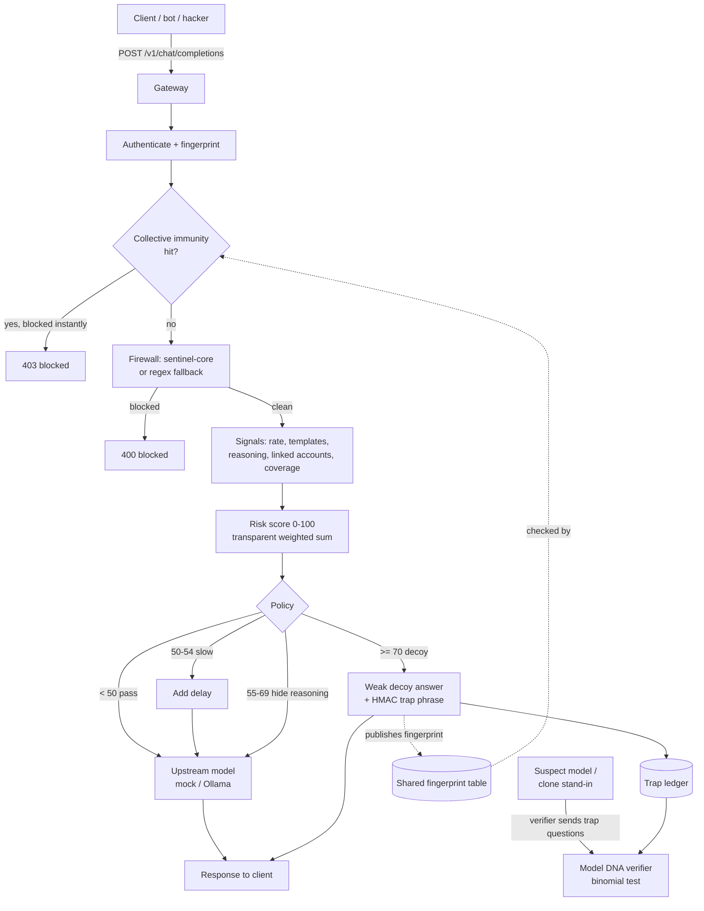

# Puaro

A protective proxy that sits in front of a company's LLM API and defends against **model theft by distillation**: an attacker sends thousands of normal-looking prompts from many accounts, saves the answers, and trains a cheap copy. Every single request looks legitimate on its own, so a normal firewall misses it.

Built for a cybersecurity ideathon. All traffic in this repo's demo, tests, and eval numbers is synthetic, generated by our own simulator scripts — see [Limits](#limits).

## The problem

A normal firewall or WAF checks one request at a time and asks "is this text malicious?" Distillation attacks don't need malicious text — every individual prompt is a perfectly ordinary question. The signal is only visible **across many requests and many accounts over time**: unusual volume, repeated templates, systematic topic-sweeping, demands for step-by-step reasoning (cheap to imitate, expensive to generate), and clusters of accounts that share infrastructure. None of that is visible to a per-request filter.

## What Puaro does

One closed loop, run per request through the gateway:

1. **Prevent** — score each account's behavior over a sliding window and tell real clients from copying bots, with a transparent, inspectable weighted sum (not a black-box model).
2. **Deceive** — confirmed copiers get weak decoy answers seeded with hidden trap phrases, without ever being told.
3. **Prove** — Model DNA: trap phrases are derived with `HMAC(secret, account_id + question_id)`. If a suspect model repeats one, we can show a match far above chance with a binomial test.
4. **Immunize** — an attacker fingerprint confirmed at one tenant is shared (as a hash only, never prompts) and blocks that origin at every other tenant on its very first request.

The customer connects by pointing one API address at Puaro. Their model stays untouched.

## Architecture



Every step's latency is logged per request (`t_auth_us`, `t_immunity_us`, `t_firewall_us`, `t_signals_us`, `t_policy_us`, `t_model_us`, `t_total_us`) and surfaced via `make eval` and the dashboard.

## The Firewall step: built on AISecurity

The Firewall step wraps the public [`sentinel-core`](https://github.com/DmitrL-dev/AISecurity) Rust pattern engine (Apache-2.0) via its Python binding, `EngineRegistry().analyze_patterns(text)`, pinned to commit [`dd432e0b`](https://github.com/DmitrL-dev/AISecurity/tree/dd432e0baed808f539780bb21d94737617b40429/sentinel-core) (same pin as their own Guard Lab tool). It is used **only** for the Firewall step (blocking prompt-injection/jailbreak text before it reaches the model) — distillation detection, decoys, Model DNA, and collective immunity are Puaro's own work, not part of that repo.

That project's own docs are explicit that its native build is documented and tested for **Linux x86-64 / Python 3.11** only, and that its accuracy numbers are historical/not independently revalidated. Per its own README, **we do not quote any of its detection percentages here.** If the native package isn't installed (e.g. on Windows, or before it's built), Puaro automatically falls back to a small regex rule set behind the identical `firewall.check(text) -> (blocked, reason)` interface — see `app/firewall.py`. The active mode is always visible in `/healthz`, the eval report, and the dashboard banner, so we never silently overclaim which engine is actually running. See [`THIRD_PARTY_NOTICES.md`](THIRD_PARTY_NOTICES.md) for full attribution.

## Stack

Python 3.11+, FastAPI, SQLite, `datasketch` (MinHash), `httpx`. No GPU required. Upstream model is configurable: a mock backend (canned answers, always works offline) by default, or Ollama (`qwen2.5:0.5b` by default) if available — the mock is used automatically if Ollama isn't reachable.

## Setup

```sh
python3.11 -m venv .venv
# Windows: .venv\Scripts\activate    macOS/Linux: source .venv/bin/activate
pip install -r requirements.txt
cp .env.example .env
```

Generate your own trap-phrase HMAC secret and put it in `.env` (never commit it):

```sh
python -c "import secrets; print(secrets.token_hex(32))"
```

`.env.example` also documents `PUARO_FIREWALL_MODE` (`auto`/`regex`/`native`) and `PUARO_MODEL_BACKEND` (`mock`/`ollama`).

## Running the demo

Start the gateway (Terminal 1):

```sh
make dev
# or: uvicorn app.main:app --reload --port 8000
```

Open the live dashboard at **http://127.0.0.1:8000/dashboard** — buttons for Send client / Send bot / Send hacker / Auto-play / Scan suspect model / Attack Customer B / Reset, a live request table with per-signal bars, and counters.

Or run the same flow from the CLI (Terminal 2), in order or individually:

```sh
python scripts/legit_users.py     # normal users + heavy Dev CI, must not be punished
python scripts/distill_bot.py     # 8 fresh accounts, shared origin, topic-sweeping, reasoning-demanding
python scripts/jailbreaker.py     # a few injection/jailbreak attempts, caught by the Firewall step
python scripts/run_demo.py        # the full pitch flow: client -> bot -> hacker -> scan -> attack Customer B
```

`run_demo.py` and the dashboard's "Auto-play" button run the exact same underlying flow (`app/demo_actions.run_full_demo`) — there's one definition of "the demo," not two that can drift apart.

## Running the eval

```sh
make eval
# or: python scripts/eval.py
```

Resets the demo database, runs the full simulator, and prints measured (not assumed) numbers:
- **Detection**: how many of the 8 bot accounts were stopped, and how many of their own requests it took
- **False positives**: how often legitimate accounts — especially Dev CI — were punished (target: 0%)
- **Latency**: p50/p95 per pipeline step, in milliseconds
- **Model DNA**: trap matches and binomial p-value, clone stand-in vs. clean upstream model

Every number in that output comes from traffic this script itself generates in that run — it is a demo-scale illustration, not an independent benchmark, and the report says so explicitly.

## Tests

```sh
make test
# or: pytest -q
```

Covers the risk score, policy thresholds, HMAC trap derivation, the binomial test, MinHash template matching, signals, the clone stand-in's exact-match-then-fuzzy lookup, collective immunity, and integration tests against the real gateway (FastAPI `TestClient`, not mocks).

## Limits — read before trusting any number here

- **All traffic is synthetic.** Every request in the tests, the dashboard demo, and `make eval` is generated by this repo's own scripts. Nothing here is a benchmark against real attacker behavior.
- **The risk score is a transparent weighted sum**, not a trained model. It was tuned by hand against exactly one scenario (a repetitive-but-narrow CI-style caller must not be punished; see the comment on `threshold_slow` in `app/config.py`) — it has not been validated against a broader population. LightGBM + SHAP is a natural next step (see Roadmap).
- **The Model DNA binomial test's chance-match rate (`p0`) is an approximation** derived from the trap-phrase word-combination space (4,096 combinations), not a measured natural-language statistic. `scripts/model_dna_verify.py` and every report it produces say this explicitly.
- **The clone "stand-in" is a nearest-neighbor lookup over harvested (question, answer) pairs, not a trained model.** It demonstrates the trap-phrase mechanism faithfully (a real distilled model trained on poisoned data would behave similarly for memorized examples) but isn't a real distillation.
- **On non-Linux dev machines (including the one this was built on), the native `sentinel-core` firewall engine is not installed** — Guard Lab's own docs only document/test a Linux x86-64 + Python 3.11 build. Puaro runs on the regex fallback firewall in that case, and says so visibly everywhere (`/healthz`, the dashboard banner, `make eval`).
- **Splitting bot volume across many accounts is a real, measured cost to detection speed.** With 8 bot accounts round-robining requests, it takes ~110-120 total requests before any single account's own rate/template/coverage signals accumulate enough to cross the decoy threshold on their own — the linked-accounts signal is what catches the swarm fast, not raw per-account volume. This is documented in `app/demo_actions.run_full_demo`, not hidden.
- **No encryption at rest**; SQLite is a single local file, fine for a demo, not for production. No TLS in local dev (add a reverse proxy for that in production).
- **Raw prompt/answer text retention** is purged on a fixed interval by an in-process `asyncio` loop (`app/main.py`); a real deployment should run this as a proper scheduled job instead.
- **Origin fingerprinting trusts `X-Forwarded-For` by default** (`PUARO_TRUST_FORWARDED_HEADERS=true`), which the local simulator needs to present many fake origins from one machine. Found during a later troubleshooting pass: left on unconditionally in a real deployment, this lets any client spoof its own fingerprint (evading detection) or spoof an innocent party's IP (getting them wrongly blocked across tenants). **Set it to `false` in production** unless a trusted reverse proxy is guaranteed to own that header — see `SECURITY.md`.
- **Request bodies over 256 KiB are rejected (413)** — also found and fixed in that pass; the gateway originally had no size limit at all, an easy memory/storage DoS vector. The check only looks at `Content-Length`, so a production deployment should also cap body size at the reverse-proxy layer.

## Roadmap

- Replace the transparent weighted-sum risk score with LightGBM + SHAP once there's enough real traffic to train on, keeping per-signal explainability.
- Validate the native `sentinel-core` firewall build on the actual deployment OS (Linux x86-64 per its own docs) instead of running the regex fallback.
- Periodic (not just on-decoy) Model DNA scans against any suspect endpoint a customer wants checked.
- Real account/key provisioning (database-backed, not an env var) and per-tenant admin approval flow for hard blocks/bans, as distinct from the four automatic soft policy actions.
- TLS termination and a proper scheduled job for the retention purge, for anything beyond local demo use.

## Credits

Firewall step built on [AISecurity](https://github.com/DmitrL-dev/AISecurity) (Apache-2.0) by Dmitry Labintsev — see [`THIRD_PARTY_NOTICES.md`](THIRD_PARTY_NOTICES.md). Distillation detection, decoys, Model DNA, and collective immunity are Puaro's own work.

See also: [`AI_USAGE.md`](AI_USAGE.md) · [`SECURITY.md`](SECURITY.md) · [`THIRD_PARTY_NOTICES.md`](THIRD_PARTY_NOTICES.md)
